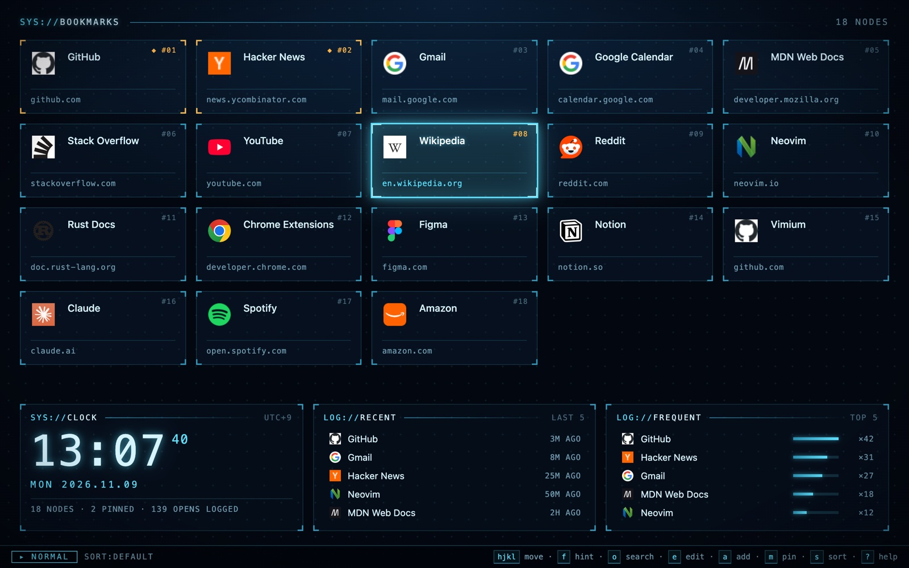
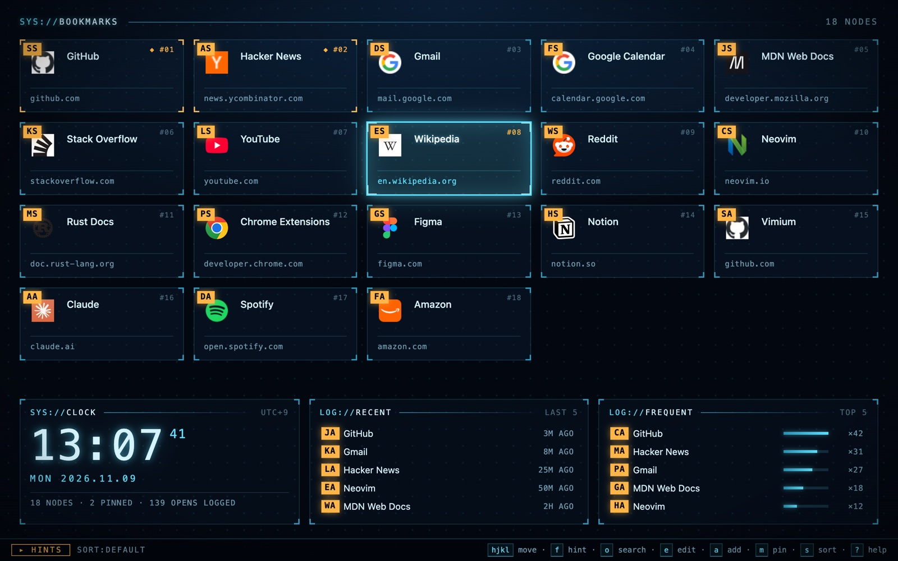
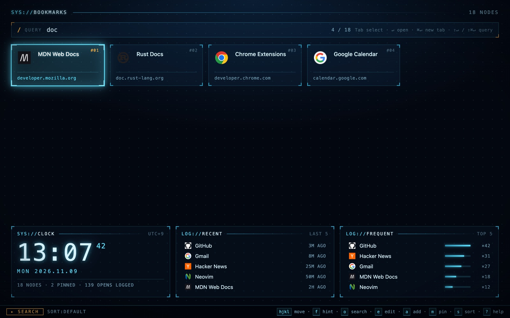

  

<h1 align="center">vim-home</h1>

  Your bookmarks, one keystroke away. 
  A Vimium-style bookmark grid for Chrome's new tab page.

Vimium gives you a blank new tab. vim-home fills it with every bookmark you
have, laid out as a grid you drive entirely from the keyboard: `hjkl` to move,
`f` for link hints, `o` to search.

## Features

**Link hints.** Press `f`, type two letters, and you're there.

**Search that falls back to the web.** `o` filters by title or URL (fuzzy
matches included). No match? `Enter` opens it as a URL or searches it.

**Plus:**

- Edit, add, delete and undo bookmarks without touching the mouse
- Pin favorites to the front; sort by bookmark order, open count or recency
- A dashboard with a clock and your recent / most-opened bookmarks
- Drag cards to reorder (it moves them in Chrome's bookmark tree too)
- Stays in sync with the bookmark manager and other tabs
- Private: open history stays in local storage, and the page makes no
  outside requests of its own

## Install

Not on the Chrome Web Store yet, so load it unpacked:

1. Clone this repository.
2. Open `chrome://extensions` and turn on **Developer mode**.
3. Click **Load unpacked** and pick the cloned folder.

Open a new tab. Press `?` any time to see every shortcut.

## Keys

| Key | Action |
| --- | --- |
| `h` `j` `k` `l` / arrows | Move |
| `gg` / `G` | First / last bookmark |
| `d` / `u` | Half page down / up |
| `Enter` / `Cmd+Enter` | Open here / in a new tab |
| `f` / `F` | Link hints (open here / in a new tab) |
| `o` / `O` | Search (open here / in a new tab) |
| `/` | Filter the grid, then pick with `hjkl` |
| `yy` / `yf` | Copy the URL of the focused / a hinted bookmark |
| `e` / `a` | Edit / add a bookmark |
| `x` / `X` | Delete (asks to confirm) / undo |
| `m` | Pin / unpin |
| `s` | Cycle sort: default → frequent → recent |
| `?` | Show all shortcuts |

`Ctrl` works wherever `Cmd` is listed. In search, `Tab` / `Shift+Tab` picks a
match; `Shift+Enter` opens the query as a URL or web search even when
bookmarks match.

## More

- [Design notes](docs/design.md) — why things work the way they do, and how to
  run the tests (`node --test`)

## License

[MIT](./LICENSE)
